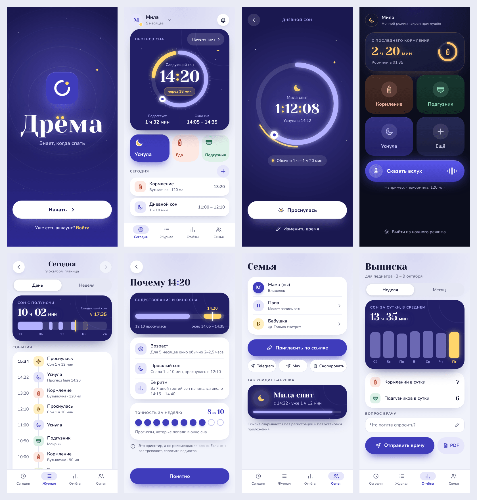

# Дрёма

**Знает, когда спать.** Веб-приложение (PWA) для родителей малыша до трёх лет: записывает сон, кормления и подгузники одним нажатием или голосом и заранее показывает, когда малыш захочет спать.



## Что внутри

- **Прогноз сна** с окном «±» и объяснением («Почему так?»): возрастной ориентир плюс ритм именно вашего ребёнка. Точность прошлых прогнозов считается честно, на прошлом («8 из 10»).
- **Ночной режим**: тёмный экран с крупными кнопками, включается сам; можно управлять одной рукой.
- **Голос**: «покормила, 120 мл и поменяла подгузник» — приложение показывает, что поняло, и записывает после подтверждения. Можно набрать фразу текстом.
- **Журнал и отчёты**: сутки, неделя, месяц; выписка для педиатра текстом, в мессенджер или на печать (PDF).
- **Семья**: приглашение и ссылка «только смотреть» для бабушки, без регистрации.
- **Работает без интернета** и ставится на экран телефона. Данные хранятся только в вашем браузере; есть сохранение и загрузка резервной копии.

## Запуск

```bash
npm install
npm run dev        # http://localhost:5173
npm run build      # собранная версия в dist/
npm run preview    # посмотреть собранную версию, http://localhost:4173
```

Нужен Node.js 22 или новее.

На GitHub приложение публикуется само из ветки `main` (вкладка Actions → «Публикация»). Один раз включите: **Settings → Pages → Source: GitHub Actions**.

## iPhone: как приложение с экрана «Домой»

Safari → «Поделиться» → **На экран «Домой»**. Приложение открывается без адресной строки и ведёт себя как обычное:

- **Экран закреплён.** Страница не прокручивается и не «резинится»; прокручиваются только списки внутри экранов. Когда выезжает клавиатура, iOS не меняет размер страницы, а накрывает её и сама «подкручивает» к полю, из-за чего всё уезжало. Поэтому `src/app/viewport.ts` следит за `visualViewport` и держит приложение ровно в видимой части: шторка с полем встаёт над клавиатурой, ничего не прыгает, нижняя навигация на время набора прячется.
- **Масштаб не меняется.** Поля ввода не мельче 16 px (иначе iOS увеличивает страницу при фокусе), масштаб закреплён в `viewport`, двойное касание не увеличивает.
- **Вырез и индикатор «Домой».** `viewport-fit=cover` и безопасные зоны (`--sat`, `--sab`): содержимое не уходит под вырез, нижняя панель выше индикатора. Строка состояния в таком режиме всегда белая, поэтому на светлых экранах под ней тёмная полоса цвета заставки (на ночном и экране сна — в цвет экрана). На iPhone без выреза и в браузере всё остаётся как в макете.
- **Заставка запуска** (`public/splash/`, 12 размеров iPhone от SE до 16 Pro Max): вместо белой вспышки при открытии.

Чтобы iOS подхватила новые настройки, значок надо удалить с экрана «Домой» и добавить заново.

Настоящую клавиатуру и вырез в Chromium не воспроизвести, поэтому проверки подставляют их: видимая область и безопасные зоны задаются вручную (`tests/viewport.test.ts`, четыре сценария `iPhone: …` в `tools/e2e/run.ts`, снимки `npm run test:ios-shots`). На самом iPhone поведение стоит проверить глазами.

## Как это устроено

| Папка | Что там |
|---|---|
| `src/engine/` | все расчёты без обращений к браузеру: прогноз, нормы, статистика, голос, напоминания, выписка |
| `src/store/` | состояние, сохранение в браузере, действия (проверка, отмена), проверка данных |
| `src/ui/` | экраны и шторки: разметка со стилями, перенесёнными из макета V3 |
| `src/app/` | маршруты, сценарии, управление детьми и семьёй, ссылки, напоминания |
| `src/demo/` | примерные данные: три недели жизни Милы |
| `design/` | макеты V3 (исходники и эталонные картинки) |
| `tools/` | пиксельная сверка с макетом, сценарии в браузере, иконки и заставки |
| `tests/` | модульные тесты |

Технологии: TypeScript (строгий режим), [lit-html](https://lit.dev/docs/libraries/standalone-templates/), Vite, vite-plugin-pwa. Шрифты — Yeseva One и Nunito, встроены в приложение (без обращений к сторонним серверам).

**Расчёты подробно, с формулами и разобранным примером, — в [docs/MECHANICS.md](docs/MECHANICS.md).**

## Проверки

```bash
npm run typecheck     # типы
npm test              # модульные тесты (≈490)
npm run test:visual   # сверка 8 экранов с макетом V3 (нужен запущенный npm run dev)
npm run test:e2e      # 28 сценариев в настоящем Chromium (нужен npm run dev или preview)
npm run test:offline  # service worker и работа без сети (нужен npm run preview)
npm run test:ios-shots # снимки «как на iPhone с вырезом и клавиатурой» в .visual/ios/ (для глаз)
npm run splash        # заново нарисовать заставки запуска для iPhone (public/splash/)
```

Для проверок в браузере: `npx playwright install chromium`; свой путь к браузеру задаётся переменной `CHROMIUM_PATH`, адрес — `BASE_URL`.

Пиксельная сверка сравнивает снимки экранов с эталонами из `design/baseline/` (допуск 0,1 % пикселей; на момент создания расхождение 0–0,015 %, это сглаживание краёв букв). В GitHub Actions та же сверка идёт в «грубом» режиме (`VISUAL_MODE=coarse`): снимки усредняются блоками 4×4, поэтому разное сглаживание букв в другой сборке Chromium не мешает, а сдвиг элементов, другой цвет или потерянный блок ломают проверку. `tools/visual/probe.ts` показывает, какими шрифтами нарисован экран и где стоят блоки текста: им удобно искать причину расхождений между машинами. Данные в снимках зафиксированы: фиксированные «часы» и демо-история, чтобы цифры в макете и в приложении совпадали (`?fixture=home|sleeping|night|day|why|family|report|splash`).

## Чего здесь нет

Живой синхронизации между телефонами и уведомлений при закрытом приложении: для них нужен сервер, а приложение работает без него. Подробнее — в разделах 8 и 11 [docs/MECHANICS.md](docs/MECHANICS.md). Ссылка «только смотреть» — снимок на момент создания, а не живая трансляция; через 6 часов она помечается устаревшей.

Приложение не даёт медицинских рекомендаций. Возрастные ориентиры — отправная точка для прогноза, а не нормы.
